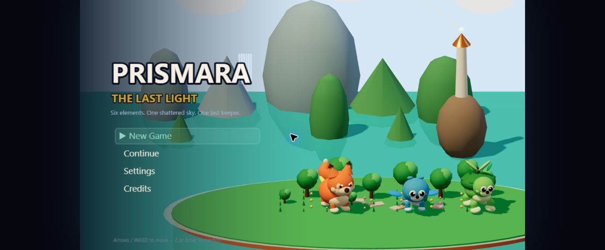
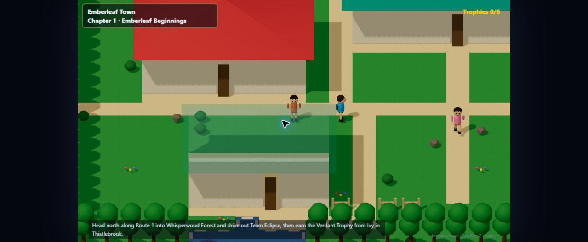
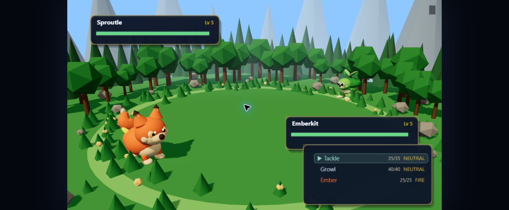

# Prismara: The Last Light

An original creature-collecting adventure for the browser. You catch and train 40 original creatures, cross a 3D island region, win six Keeper Trophies and stop Team Eclipse before the last beacon goes dark.

Built with **TypeScript**, **Phaser 3** (gameplay, input, UI) and **Three.js** (the 3D world, creatures and battle arenas). Every model, texture, sound effect and music track is generated in code, so the project ships no art or audio files.



| Overworld | Battle |
| --- | --- |
|  |  |

## The story

Your mother kept the last lighthouse on the isles until the night the sky prism fractured, and she vanished with its light. With her waterlogged journal and your partner creature, you set out across Prismara to wake six sleeping beacons. Your friend Kai is chasing a brother who joined Team Eclipse, and Eclipse's leader Voss wants to freeze the world in twilight so nothing can ever break again.

## Features

- **40 creatures** across six elements, with evolutions, abilities, shinies and three legendaries
- **37 maps**: towns, routes, a forest, caves, a volcano, ruins and a summit, with field abilities that open new paths
- **A turn-based battle engine** with type matchups, status conditions, weather, stat stages, crits, trainer AI tiers and catching
- **Six Keeper Trials**, rival battles, a villain team and a Champion finale
- **A Field Journal** with chapter objectives, side quests and rewards, a trophy cabinet and a region atlas
- **10 capture orbs** with situational bonuses (night, water, first turn, timer and more)
- **Day/night cycle**, shops, healing centers, PC storage, a creature dex and evolution scenes
- **Autosave plus three manual save slots**, stored in the browser
- **Procedural audio**: chiptune music sequencer, synthesized sound effects and generated creature cries
- **Accessibility settings**: reduced effects, toggleable damage numbers and battle animations, and touch controls

## Play locally

Requires Node.js 18+ and a browser with WebGL.

```bash
git clone https://github.com/prakky10/prismara.git
cd prismara
npm install
npm run dev
```

Open the URL Vite prints (default http://localhost:5175). Saves live in that browser and origin, so use the same host and port to continue a game.

### Controls

| Action | Keys |
| --- | --- |
| Move | Arrow keys / WASD |
| Run | Shift |
| Talk / confirm | Z or Enter |
| Back | X or Escape |
| Menu | C or Tab |

## Project layout

```
src/
  audio/      music sequencer, SFX synth, creature cries
  battle/     pure battle engine: damage, status, weather, AI, capture, turn resolution
  core/       game state, save system, input, seeded RNG, clock
  data/       creatures, moves, abilities, items, type chart
  render/     Three.js world/creature/arena rendering, tile painting, move VFX
  scenes/     Phaser scenes (title, overworld, battle, menus...)
    battle/     battle event playback, status panels, menu builders
    overworld/  overworld HUD
  ui/         panels, menus, text boxes, HP bars, popups
  world/      maps (one module per region), campaign, trainers, encounters, field rules
tests/        Vitest suites for the engine, campaign, saves and world
scripts/      world audit tooling
```

The battle engine and world rules are plain TypeScript with no Phaser dependency. Scenes only turn their results into animation, which keeps the rules unit-testable.

## Development

```bash
npm test            # unit tests (Vitest)
npm run typecheck   # strict TypeScript
npm run lint        # ESLint
npm run build       # typecheck + production build into dist/
npm run audit:world # check map warps and connectivity
```

## Credits

Prismara is a fan-made, original game inspired by the creature-collecting RPG genre. All creatures, characters, places and story are original to this project. It is not affiliated with or endorsed by Nintendo, Game Freak or The Pokémon Company.
